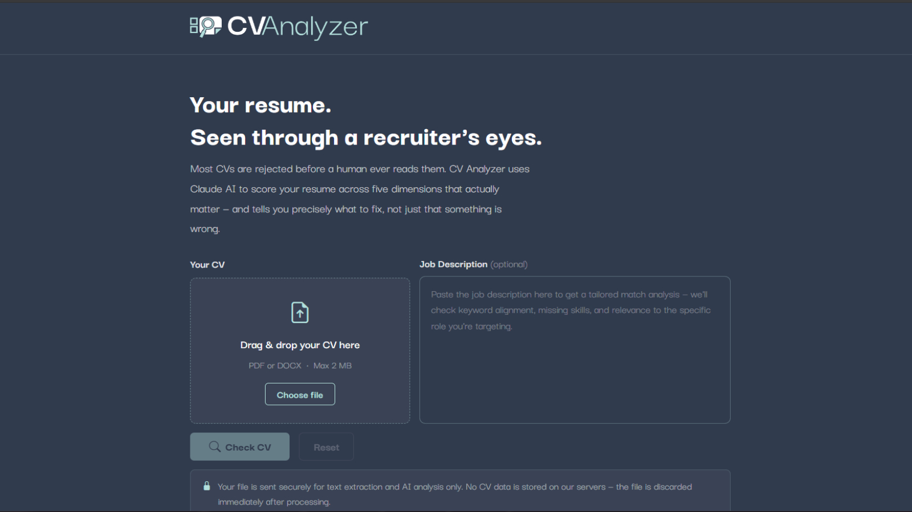
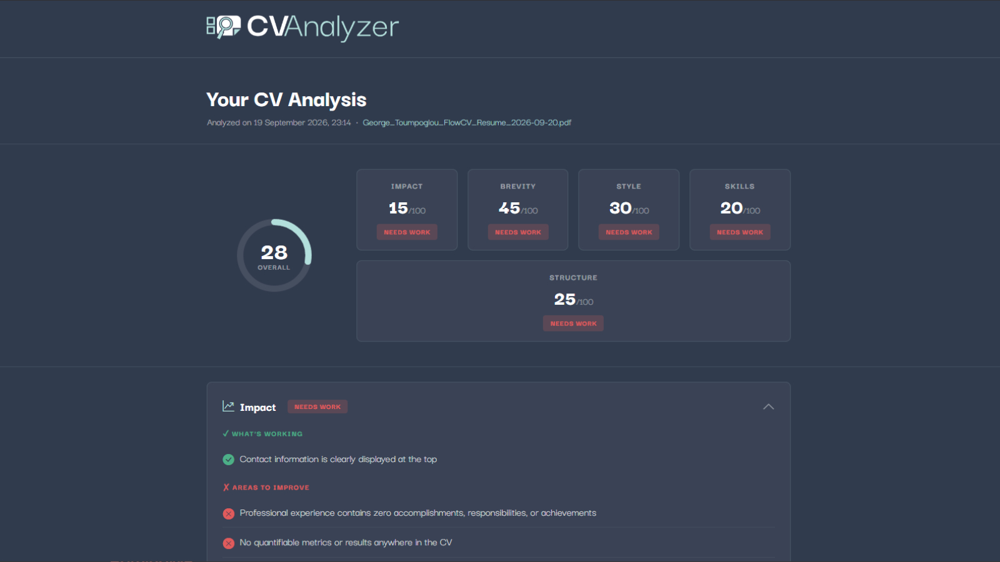

# CV Analyzer 📄

An AI-powered web app that reviews your CV. Upload a PDF or DOCX file and get an overall score, detailed feedback across five key areas and clear recommendations on what to improve. Optionally, paste a job description to see how well your CV matches the role.



## Features

- Drag-and-drop upload for PDF and DOCX files (up to 2 MB)
- Overall CV score with an animated circular score display
- Detailed scoring across 5 areas: **Impact, Brevity, Style, Skills and Structure**
- Collapsible feedback cards per area, listing specific strengths and weaknesses
- A summary of the most important changes to make
- Optional **job match**: paste a job description to get a match score and the most critical gaps
- Works with CVs in any language (feedback is always in English)
- Clear error messages for empty, image-only or unsupported files
- No sign-up and no database: files are processed in memory and never stored

## Screenshots

**Analysis results**



## How it works

1. The uploaded file is read in memory and its text is extracted with **PyMuPDF** (PDF) or **python-docx** (DOCX).
2. The text is sent to the **Anthropic Claude API** together with a scoring guide, asking for a strictly structured JSON response.
3. The JSON (scores, positives, negatives and recommendations) is parsed in Python and rendered as the results page.

## Tech stack

- **Backend:** Python, Flask
- **AI:** Anthropic Claude API
- **File parsing:** PyMuPDF, python-docx
- **Frontend:** HTML, CSS, JavaScript, Bootstrap 5, Bootstrap Icons
- **Deployment:** Render (Gunicorn)

## Run locally

```bash
# Clone the repository
git clone https://github.com/georgios-toumpoglou/CV-analyzer.git
cd CV-analyzer

# Create and activate a virtual environment
python -m venv venv
venv\Scripts\activate        # Windows
# source venv/bin/activate   # macOS / Linux

# Install dependencies
pip install -r requirements.txt

# Run the app
python main.py
```

Then open http://127.0.0.1:5000 in your browser.

### Environment variables

Create a `.env` file in the project folder (it is loaded automatically and excluded from Git):

```env
ANTHROPIC_API_KEY=your-anthropic-api-key
SECRET_KEY=your-secret-key
```

| Variable | Description | Required |
|---|---|---|
| `ANTHROPIC_API_KEY` | API key from the [Anthropic Console](https://console.anthropic.com), used to analyze the CVs | Yes |
| `SECRET_KEY` | Flask secret key, used for error messages | Yes |

## Live demo

A live version is available on request. Feel free to contact me through [LinkedIn](https://www.linkedin.com/in/georgios-toumpoglou).

## Author

**Georgios Toumpoglou**
[GitHub](https://github.com/georgios-toumpoglou) · [LinkedIn](https://www.linkedin.com/in/georgios-toumpoglou)
